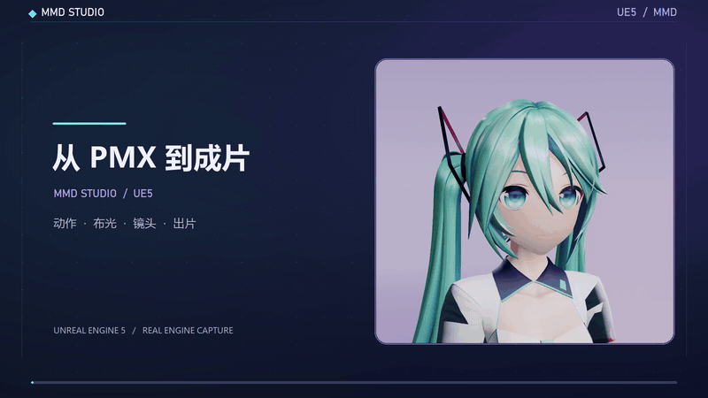

# Ue5MMDTools

[简体中文](README.md) · [English](README.en.md) · **日本語**

**Unreal Engine 5 で、PMX モデルから MMD のショート動画まで。**

PMX と VMD を読み込み、**MMD STUDIO（キャラクター工房）** でモーションを試し、髪と服の物理、照明、カメラを確認して、そのまま MP4 に書き出せます。書き出したモーション・表情・カメラは Sequencer でさらに編集できます。

> **省けるのは真ん中の工程です。** 物理、照明、カメラ、エンコードまでプラグインの中で完結します。MMD のデータをそのまま持ち込み、絵が決まったら書き出すだけ。1 カットのために Blender、MMD、UE を行き来する必要はありません。

[Win64 プラグインをダウンロード](https://github.com/treasureGrove/MMDUETools/releases/latest) · [5 分で導入](#インストール) · [操作ガイド（英語）](github.en.md) · [操作ガイド（中国語）](github.md) · [デモ動画](https://www.bilibili.com/video/BV1M2RXBPExk/)

  

<em>約 19 秒の操作抜粋。最後に映るのが、この操作で実際に出力された MP4 です。</em>

## できること

- PMX のジオメトリ、マテリアル、スケルトン、モーフ、MMD 物理データを読み込む
- VMD のボーンアニメーション、モーフ、カメラを読み込む（自分の VMD も可）
- Bullet による髪と服の物理をプレビュー。ポーズを固定したまま物理だけ進められる
- 8 種類のスタジオと Toon スタイル、全身／半身／顔／横／後ろの 5 カメラ
- 現在のプレビューを 30 fps の MP4 に書き出し（FFmpeg / FFprobe）
- コマンドラインから `import-pmx` / `import-vmd` / `render` を実行し、結果を JSON で受け取る

## 対応範囲

| 機能 | 状態 |
| --- | --- |
| PMX モデルの読み込み | 使用可 |
| VMD ボーンアニメーション | 使用可 |
| VMD モーフ（表情） | 使用可 |
| Bullet 物理プレビュー | 使用可 |
| スタジオ・照明・スタイルのプリセット | 使用可 |
| Sequencer でのアニメーションとカメラ | 使用可 |
| プレビューからの MP4 書き出し | 使用可 |
| コマンドラインからの入出力 | 使用可 |
| UE 5.8.3 / Win64 | 検証済み |
| UE 5.6 / 5.7 | 未検証 |

`main` はプラグイン配布用のツリーです。`Ue5MMDTools/` をプロジェクトの `Plugins/` に置くだけで使えます。開発用のホストプロジェクトは [`dev` ブランチ](https://github.com/treasureGrove/MMDUETools/tree/dev) にあります。ネイティブの Toon スタイルには D3D12 SM6 と Substrate／バックエンドの設定が必要です（[ビルドと互換性](docs/BUILD_ENVIRONMENT.md)）。

**UI は現在中国語のみです。** 英語・日本語 UI はこれからの対応です。ボタンの位置は[操作ガイドのスクリーンショット](github.md)で確認できます。

## インストール

1. [最新リリース](https://github.com/treasureGrove/MMDUETools/releases/latest) から Win64 の ZIP を取得し、中の `Ue5MMDTools/` を `YourProject/Plugins/` に置く
2. プラグインを有効にしてエディタを再起動する
3. **ウィンドウ → Ue5MMDTools** でキャラクター工房を開く
4. 使用権のある PMX を **Import PMX Model** で読み込む（2 回目以降は **Load Existing Character**）
5. モーション、スタジオ、カメラを選び、右上の **現在のプレビューで制作** を押すと `Saved/MMDProduction/` に MP4 が出力される

MP4 の書き出しには Windows D3D12 SM6 と、PATH の通った `ffmpeg` / `ffprobe` が必要です。プラグインに PMX・モーション・音声は同梱していません。デモと同じ絵を作る場合は [MODEL_SOURCES.md](MODEL_SOURCES.md) から作者の配布ページを開いてください。

## 他のツールとの比較

| | Ue5MMDTools | Blender MMD Tools → FBX → UE | MMD2Unreal / IM4U |
| --- | --- | --- | --- |
| PMX／VMD の取り込み | プラグイン内で直接 | Blender 経由。材質とモーフを作り直すことが多い | プラグイン内で直接 |
| 髪と服の物理 | Bullet を内蔵。ポーズ固定で物理だけ継続 | Blender で事前ベイク | KawaiiPhysics／独自ソルバ |
| 照明とステージ | 8 種類のスタジオとスタイルをワンクリック | 自分で組む | 内蔵ステージなし |
| 書き出し | プレビューがそのまま作品。MP4 と連番 | Movie Render Queue を自分で設定 | 自分で設定 |
| ライセンス | MIT（商用可） | 各プロジェクト次第 | 各リポジトリを確認 |

取り込みの忠実度（SDEF、IK のリアルタイム評価、VMD への書き戻し）では [MMD2Unreal](https://github.com/JDui/MMD2Unreal) と [IM4U](https://github.com/tekifuta/IM4U) のほうが細かい部分まで対応しています。このプラグインが解くのは「今日この 1 本を出せるか」です。併用もできます。

## ライセンスとクレジット

コードは MIT ライセンスです。同梱しない第三者のモデル、モーション、音声、画像はそれぞれの作者のライセンスに従い、本プロジェクトが再許諾するものではありません。デモ画像のクレジットは[中国語ページの借物表](README.md#借物表)と [MODEL_SOURCES.md](MODEL_SOURCES.md) にまとめてあります。
