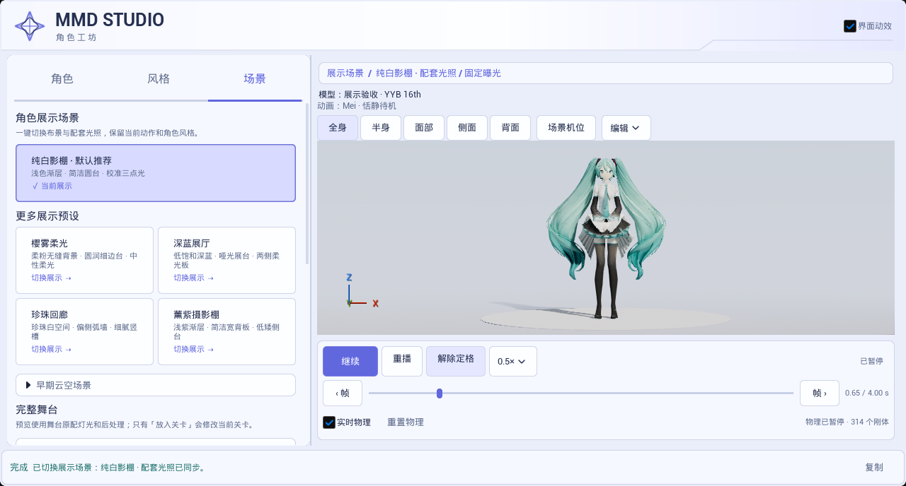
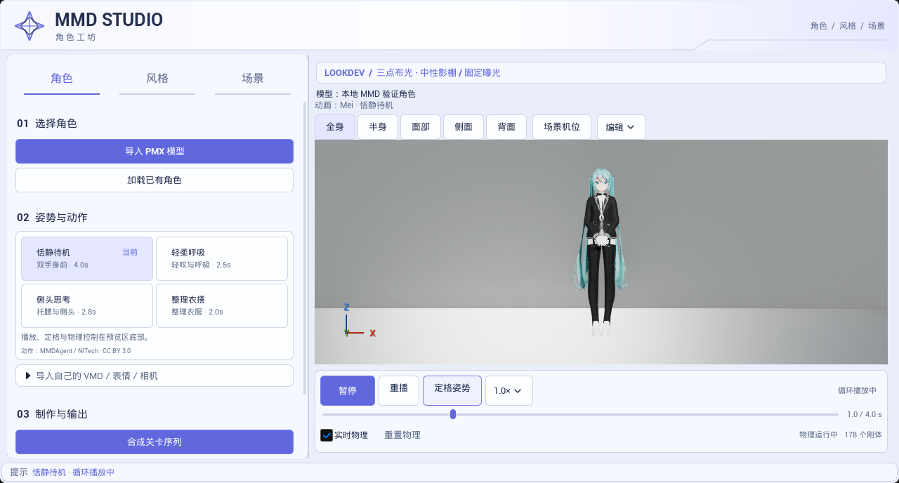
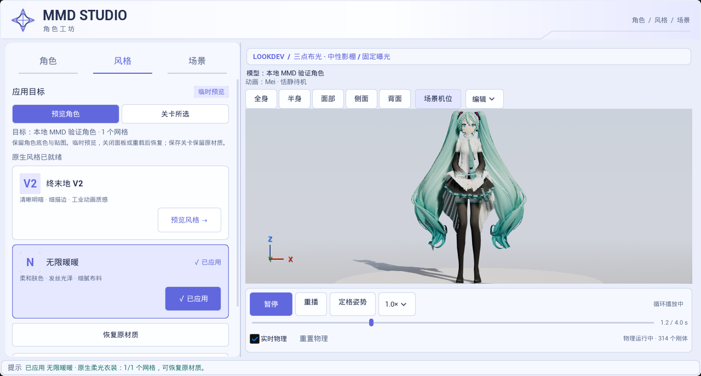
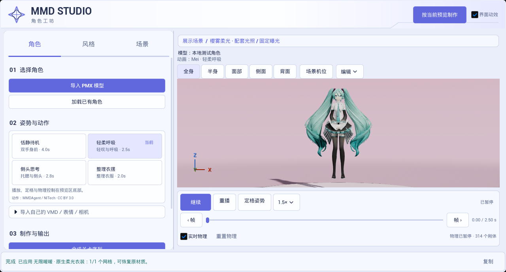

# Ue5MMDTools

Ue5MMDTools 是 Unreal Engine 5 的 MMD 导入与制作插件。可以把 PMX 角色和 VMD 动作、表情、相机导入 UE，在 **MMD STUDIO / 角色工坊** 里预览动作、实时物理和渲染风格，再保存动画资产或合成关卡序列。

*2026-10-25 引擎实拍。纯白影棚为默认展示场景，右侧底栏的播放与物理控制不随页签切换。见[截图来源与角色署名](MMD/Plugins/Ue5MMDTools/Docs/Screenshots/2026-10-25-studio-collection/README.md)。*

[展示页](https://treasureGrove.github.io/MMDUETools/) · [B 站演示](https://www.bilibili.com/video/BV1M2RXBPExk/) · [完整面板指南](MMD/Plugins/Ue5MMDTools/Docs/TOOL_PANEL_GUIDE.md)

## 安装

1. 将仓库内的 [`MMD/Plugins/Ue5MMDTools/`](MMD/Plugins/Ue5MMDTools/) 整体复制到自己的 UE 工程 `Plugins/` 下，确认目标为 `YourProject/Plugins/Ue5MMDTools/Ue5MMDTools.uplugin`。仓库根目录下的 `Plugins/` 不是安装来源。
2. 当前源码面向 **UE 5.8 / Win64**，需要该引擎的 C++ 编译工具链。Bullet 头文件和 Windows 库已随源码提供。启用插件并按 UE 提示编译、重启。
3. 进入关卡编辑器，打开 **窗口（Window） → Ue5MMDTools**。也可在编辑器控制台运行 `MMD.OpenPanel`。

> 仅安装插件时使用自己的 UE 工程即可。仓库内的 `MMD.uproject` 是开发宿主，还声明了 `ModelContextProtocol`、`AllToolsets` 和 `ToolsetRegistry` 等本仓库未附带的依赖。自定义原生渲染后端另有固定引擎版本要求，见下文。

## 快速上手

### 1. 载入角色与动作

在 **角色** 页点击 **导入 PMX 模型**，选择 `.pmx` 文件，保留模型与贴图的相对路径。等待底部提示完成，右侧显示角色。已经导入过时，使用 **加载已有角色**，选择对应的 MMD Actor 蓝图。普通导入产物可在内容浏览器的 `/Game/MMDModels` 下找到。

标准 MMD 骨架加载后默认尝试播放 **恬静待机**。也可直接选择 **轻柔呼吸 / 侧头思考 / 整理衣摆**。底部 **实时物理** 需要模型包含刚体数据；可通过播放、定格、时间轴和逐帧按钮检查姿势。

*2026-10-23 角色页实拍，用于对照导入和动作入口；当前版本的底栏另有逐帧按钮。内置动作见[MMDAgent / NITech 署名与许可](MMD/Plugins/Ue5MMDTools/Resources/PreviewMotions/README.md)。*

### 2. 选择风格与场景

1. 切到 **风格**，目标保持 **预览角色**。搜索或找到 **终末地 V2**、**无限暖暖** 等卡片，再点 **预览风格 →**。这次切换是临时的，随时可点 **恢复原材质**。
2. 切到 **场景**。保留默认 **纯白影棚**，或选择 **樱雾柔光 / 深蓝展厅 / 珍珠回廊 / 薰紫摄影棚**。场景卡会一起切换展示布景和配套光照；三套旧云空场景收在折叠区。
3. 用视口上方的 **全身 / 半身 / 面部 / 侧面 / 背面** 检查镜头。完整舞台的 **预览舞台** 只影响预览区；需要把舞台加入当前关卡时才点 **放入关卡**。

*2026-10-23 风格应用实拍，用于对照目标与卡片按钮；当前界面另有搜索，恢复入口的位置也已调整。*

### 3. 保存动画或合成序列

在 **角色 → 导入自己的 VMD／表情／相机** 中使用 **导入 VMD 动作** 生成 `AnimSequence`，按需 **追加表情** 或 **导入 VMD 相机**。内置动作卡可以直接用于预览和后台 MP4。需要单独保存内置动作资产时，从[内置动作目录](MMD/Plugins/Ue5MMDTools/Resources/PreviewMotions/)导入对应 VMD。

打开 **合成关卡序列**，核对 `Model`、`Animation` 和 `Camera` 后点 **Create Master Sequence**。导入 VMD 相机会填入相机槽，**烘焙物理动画**完成后会填入动画槽。需要沿用当前预览机位、风格和展示布景时，使用下一节的后台制作入口。

## 后台生成 MP4

保存导入的角色后，在面板里选好动作、风格、展示场景和透视机位，点击顶部的 **按当前预览制作**。后台从动作第 0 秒开始输出 30 fps MP4，沿用预览画幅、倍速与物理开关。进度和取消按钮留在面板，文件写入 `Saved/MMDProduction/`。需要 Windows D3D12 SM6 以及可调用的 `ffmpeg` 和 `ffprobe`。

*2026-11-04 离屏实拍。图中选择了轻柔呼吸、樱雾柔光、全身机位与 1.5 倍速。[截图来源与角色署名](MMD/Plugins/Ue5MMDTools/Docs/Screenshots/2026-11-04-preview-production/README.md)*

需要 VMD 镜头、独立表情或音乐时，可用脚本指定素材。后台会输出 PNG 帧、MP4、动画和序列；在编辑器内执行 `MMD.OpenProduction "作品目录"` 可重开动作和镜头。[后台制作指南](MMD/Plugins/Ue5MMDTools/Docs/MMD_PRODUCTION_WORKFLOW.md)

*2026-10-25 实际 UE 后台成片第 15 帧。插件打包规则会排除测试角色源文件和模型贴图。[五套场景对照与视频](MMD/Plugins/Ue5MMDTools/Docs/Screenshots/2026-10-25-studio-collection/README.md)*

## 原生风格与兼容性

- 终末地 V2 和无限暖暖的**插件自定义原生后端**依赖 **UE 5.8.3 / CL58210709 / Win64 D3D12 SM6**，并需显式启用 Substrate 和后端。按[配置模板](MMD/Plugins/Ue5MMDTools/Scripts/EndfieldNative.example.ini)与[原生渲染指南](MMD/Plugins/Ue5MMDTools/Docs/ENDFIELD_NATIVE_RENDERING_GUIDE.md)合并相关配置，保留本工程的阴影与其他设置，再重启。仅应用风格卡片不保证进入截图中的原生渲染路径。
- Reference 和旧风格保留独立的兼容路径。通用发丝、布料和描边的参数见[舞台与 Reference 预设说明](MMD/Plugins/Ue5MMDTools/Docs/STAGE_RENDER_PRESETS.md)。插件的原生适配不修改安装引擎文件。
- 不同模型的骨骼命名、IK 和特殊 Morph 可能需要适配。材质、骨骼及 UV Morph 尚未完整支持为 UE 动画通道。

更多资料：[文档入口](MMD/Plugins/Ue5MMDTools/Docs/README.md) · [渲染架构](MMD/Plugins/Ue5MMDTools/Docs/RENDERING_ARCHITECTURE.md) · [源码构建与分发验证](MMD/Plugins/Ue5MMDTools/Docs/ENDFIELD_PLUGIN_DISTRIBUTION.md) · [修改记录](MMD/Plugins/Ue5MMDTools/Docs/CHANGELOG.md)
