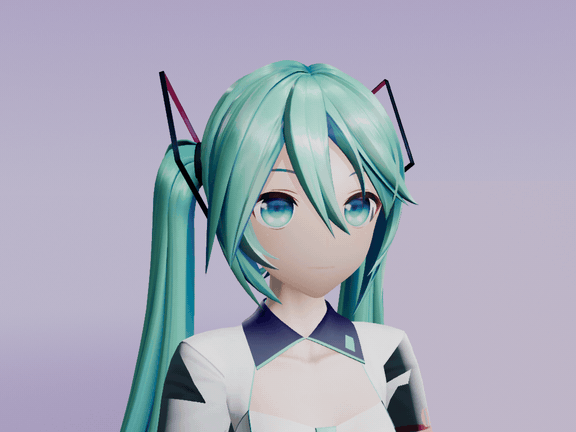
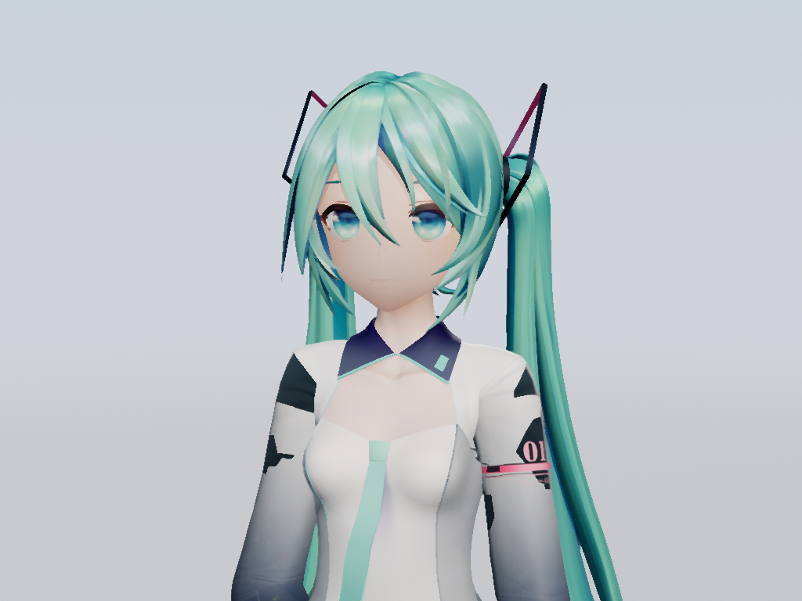
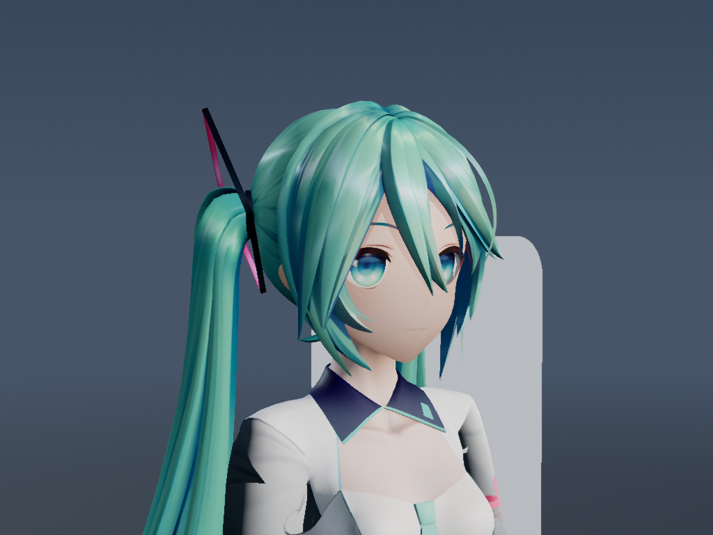
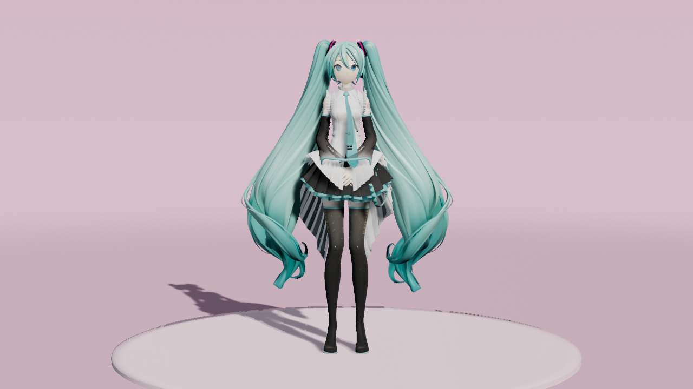
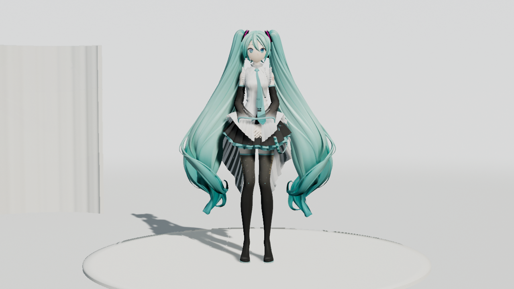
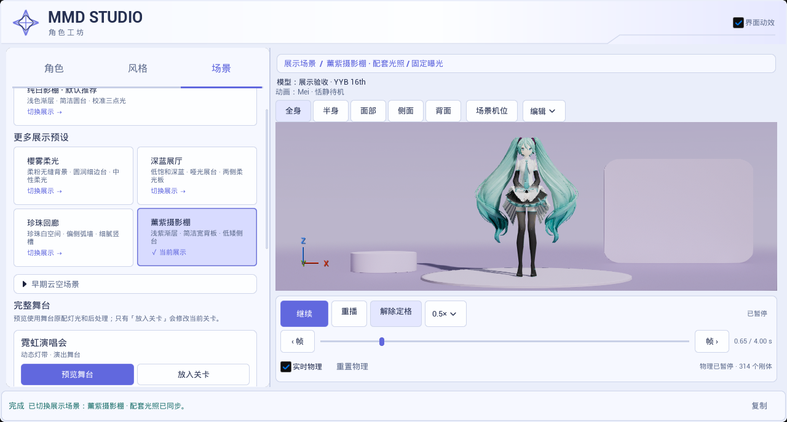

# Ue5MMDTools

**在 Unreal Engine 5 里，从 PMX 角色做到 MMD 短片。**

导入 PMX 和 VMD，在 **MMD STUDIO / 角色工坊** 里试动作、看发丝和衣物物理、换布光、定镜头。满意后直接后台生成 MP4，也可把动作、表情和相机带入 Sequencer 继续编辑。

[下载 Win64 插件包](https://github.com/treasureGrove/MMDUETools/releases/latest) · [图文操作指南](github.md) · [B 站演示](https://www.bilibili.com/video/BV1M2RXBPExk/)

[待机动图](#待机动作预览) · [镜头与布光](#镜头与布光) · [角色工坊](#角色工坊) · [快速上手](#快速上手) · [借物表](#借物表)

## 待机动作预览

  

<em>10 周年初音未来 · 薰紫摄影棚 · 侧脸待机</em>

3.2 秒的侧脸待机，加入 VMD 眨眼和轻微嘴角变化。发丝与衣物使用 Bullet 物理。由 `main` 开发版在 UE 5.8.3 中离屏渲染。[捕获记录](MMD/Plugins/Ue5MMDTools/Docs/Screenshots/2026-11-05-nikki-face-fill/README.md) · [借物表](#借物表)

## 镜头与布光

<table>
  <tr>
    <td align="center" width="50%">
      
       <strong>纯白影棚 · 胸像</strong>
    </td>
    <td align="center" width="50%">
      
       <strong>深蓝展厅 · 侧脸</strong>
    </td>
  </tr>
</table>

同一位 10 周年初音，从纯白影棚的胸像切到深蓝展厅的侧脸特写。两张画面均为 2026-11-05 实际成片帧，点击图片可查看原图。[拍摄记录](MMD/Plugins/Ue5MMDTools/Docs/Screenshots/2026-11-05-homepage-gallery/README.md)

### 换一套影棚看看

<table>
  <tr>
    <td align="center" width="50%">
      
       <strong>樱雾柔光 · 柔粉背景</strong>
    </td>
    <td align="center" width="50%">
      
       <strong>珍珠回廊 · 暖白漫射光</strong>
    </td>
  </tr>
</table>

这组全身对照取自 2026-10-25 的影棚实拍。同一角色、机位与动作时间，切换场景时布景和配套光照一起更换。默认场景为纯白影棚。[播放五套影棚短片](MMD/Plugins/Ue5MMDTools/Docs/Screenshots/2026-10-25-studio-collection/studio-collection.mp4) · [查看五套逐帧对照](MMD/Plugins/Ue5MMDTools/Docs/Screenshots/2026-10-25-studio-collection/README.md)

## 角色工坊

*2026-10-25 的实际场景页。左边选择布景，右边调整镜头，播放和物理控制集中在底栏。*

- **角色与动作**　导入 PMX，载入已有角色。直接试恬静待机、轻柔呼吸、侧头思考、整理衣摆，也可导入自己的 VMD 动作、表情和相机。
- **实时物理**　在播放时观察头发和衣物。定格姿势会锁住动作时间并继续模拟物理，暂停和逐帧适合检查手部接触或穿插。
- **材质、布景与镜头**　预览角色风格并随时恢复原材质。场景卡一键切换灯光与布景，视口提供全身、半身、面部、侧面与背面机位。
- **制作与输出**　选好动作、展示场景和透视镜头后，点 **按当前预览制作**。后台按预览画幅、倍速和物理设置输出 30 fps MP4。需要编辑时可合成关卡序列，并使用物理烘焙结果。[制作按钮实拍](MMD/Plugins/Ue5MMDTools/Docs/Screenshots/2026-11-04-preview-production/README.md)

## 快速上手

1. 解压 UE 5.8.3 Win64 插件包，将 `Ue5MMDTools/` 放进自己工程的 `Plugins/` 目录。启用插件并重启。
2. 从 **窗口 → Ue5MMDTools** 打开角色工坊，导入 PMX 或加载已有角色，选择动作、场景和镜头。
3. 保存角色和动画，点 **按当前预览制作**。Windows D3D12 SM6 环境需能调用 `ffmpeg` 和 `ffprobe`，完成后在 `Saved/MMDProduction/` 找到 MP4。

[完整图文步骤](github.md) · [后台制作指南](MMD/Plugins/Ue5MMDTools/Docs/MMD_PRODUCTION_WORKFLOW.md) · [技术文档](MMD/Plugins/Ue5MMDTools/Docs/README.md) · [修改记录](MMD/Plugins/Ue5MMDTools/Docs/CHANGELOG.md)

## 借物表

- **角色**　初音未来，Crypton Future Media, INC.。[角色许可](https://piapro.jp/license/pcl)
- **待机动图与胸像、侧脸**　三目YYB（SANMUYYB）的初音未来 10 周年版 v1.02，用于非商业演示。[作者配布](https://bowlroll.net/file/146083)
- **全身对照与面板实拍**　YYB Hatsune Miku 16th NoWing，SANMUYYB／霁行Ralker／Delta幻黑，用于非商业演示。[影棚捕获记录](MMD/Plugins/Ue5MMDTools/Docs/Screenshots/2026-10-25-studio-collection/README.md)
- **动作**　Wait of Mei，名古屋工业大学计算机科学系 MMDAgent Project Team。10 周年待机另配眨眼和轻微嘴角变化。[动作来源与 CC BY 3.0 许可](MMD/Plugins/Ue5MMDTools/Resources/PreviewMotions/README.md)
- **布景与布光**　Ue5MMDTools 展示场景。
