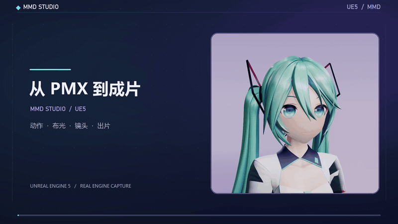
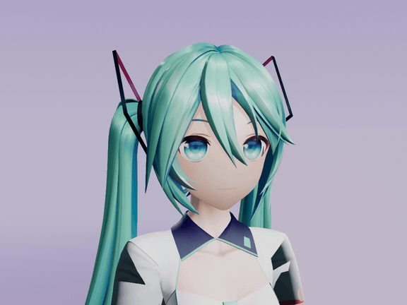
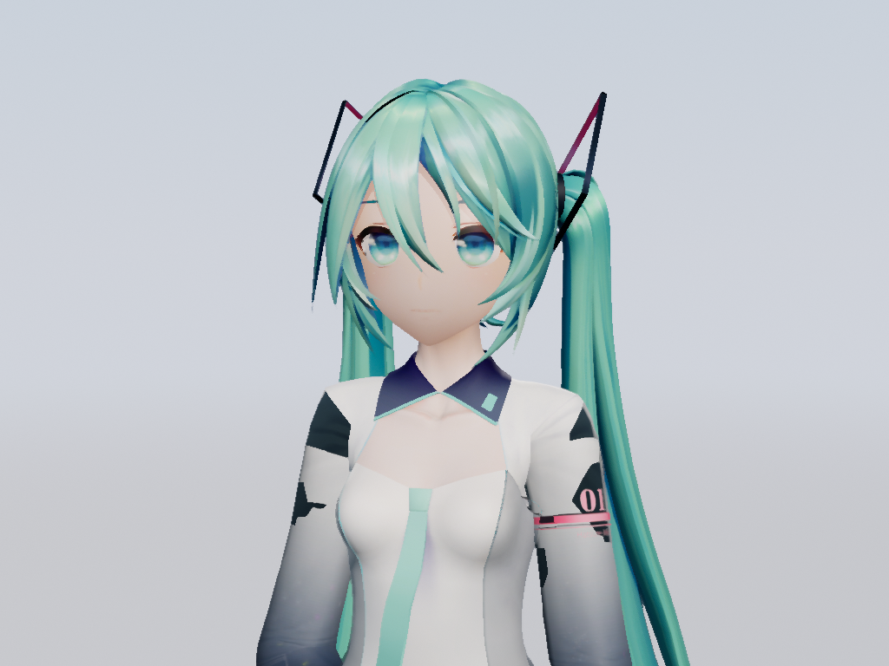
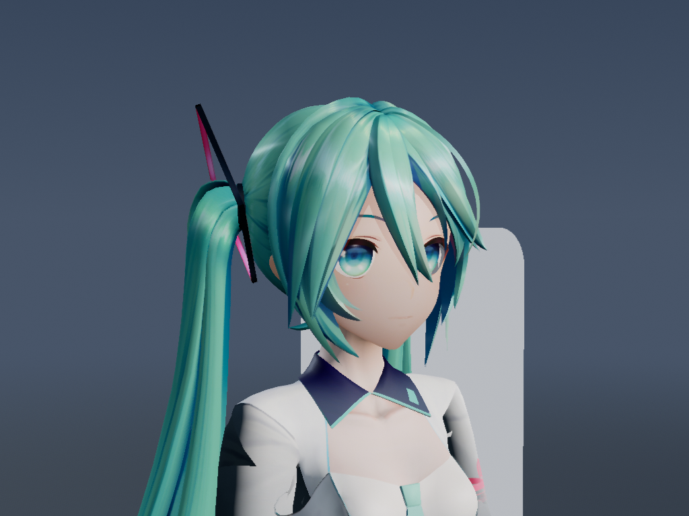
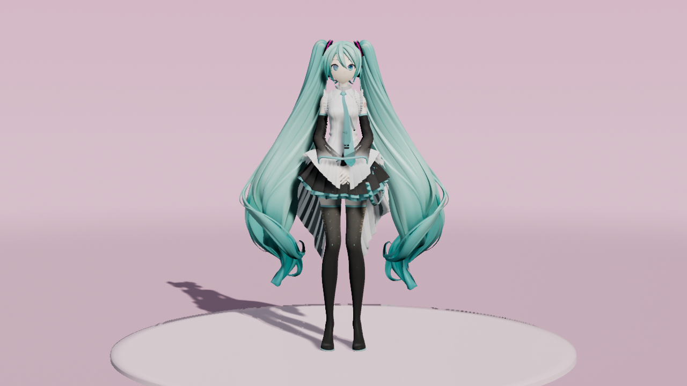
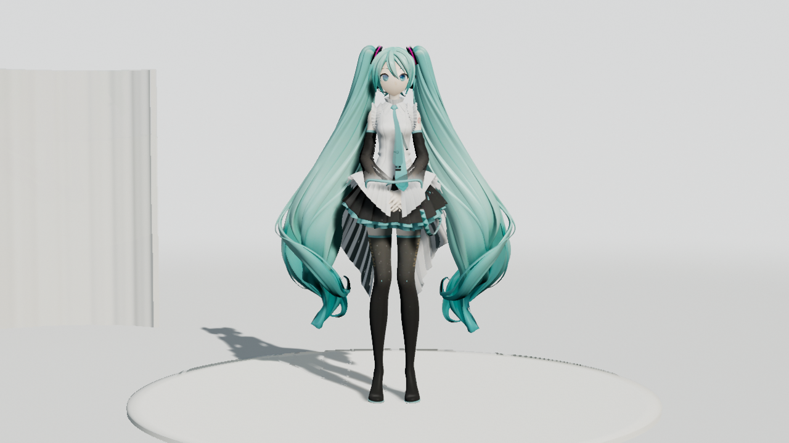
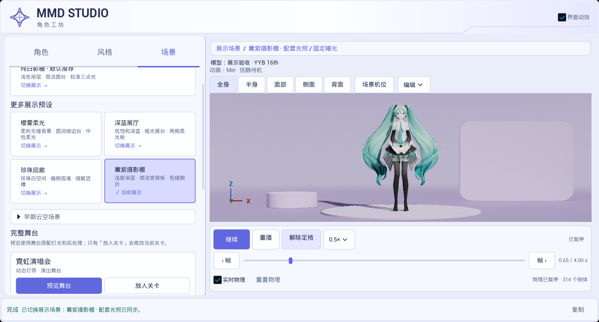

# Ue5MMDTools

[](https://github.com/treasureGrove/MMDUETools/releases/latest)
[](docs/BUILD_ENVIRONMENT.md)
[](LICENSE)
[](https://github.com/treasureGrove/MMDUETools/stargazers)

**简体中文** · [English](README.en.md) · [日本語](README.ja.md)

**在 Unreal Engine 5 里，从 PMX 角色做到 MMD 短片。**

导入 PMX 和 VMD，在 **MMD STUDIO / 角色工坊** 里试动作、看发丝和衣物物理、换布光、定镜头。满意后直接后台生成 MP4，也可把动作、表情和相机带入 Sequencer 继续编辑。

> **它省掉的是中间那一段。** 物理、布光、机位和编码都在插件里；MMD 的数据原样进来，画面调到满意就出片。要精修再进 Sequencer，不必在 Blender、MMD 和 UE 之间反复导。

[下载 Win64 插件包](https://github.com/treasureGrove/MMDUETools/releases/latest) · [五分钟上手](#快速上手) · [图文操作指南](github.md) · [B 站演示](https://www.bilibili.com/video/BV1M2RXBPExk/)

[操作视频](#操作视频) · [待机动图](#待机动作预览) · [镜头与布光](#镜头与布光) · [角色工坊](#角色工坊) · [快速上手](#快速上手) · [支持范围](#支持范围) · [和同类工具比](#和同类工具比) · [借物表](#借物表)

## 操作视频

<p align="center">
  <a href="docs/Screenshots/2026-11-05-workflow-video/mmd_studio_workflow.mp4?raw=true"></a>
</p>

**约 19 秒看完角色工坊的制作流程。** 从角色已载入开始，选轻柔呼吸、打开场景页、换薰紫摄影棚、切面部机位，再点击「按当前预览制作」。片尾是本次操作实际生成的成片。

[下载完整操作视频（MP4）](docs/Screenshots/2026-11-05-workflow-video/mmd_studio_workflow.mp4?raw=true) · [拍摄记录与借物表](https://github.com/treasureGrove/MMDUETools/blob/dev/MMD/Plugins/Ue5MMDTools/Docs/Screenshots/2026-11-05-workflow-video/README.md) · [逐步操作指南](github.md#从角色到短片)

## 待机动作预览

<p align="center">
  
</p>
<p align="center"><em>10 周年初音未来 · 薰紫摄影棚 · 侧脸待机</em></p>

3.2 秒的侧脸待机，加入 VMD 眨眼和轻微嘴角变化。发丝与衣物使用 Bullet 物理。由 `main` 开发版在 UE 5.8.3 中离屏渲染。[捕获记录](https://github.com/treasureGrove/MMDUETools/blob/dev/MMD/Plugins/Ue5MMDTools/Docs/Screenshots/2026-11-05-nikki-face-fill/README.md) · [借物表](#借物表)

## 镜头与布光

<table>
  <tr>
    <td align="center" width="50%">
      <a href="docs/Screenshots/2026-11-05-homepage-gallery/studio_portrait.png"></a>
      <br><strong>纯白影棚 · 胸像</strong>
    </td>
    <td align="center" width="50%">
      <a href="docs/Screenshots/2026-11-05-homepage-gallery/slate_portrait.png"></a>
      <br><strong>深蓝展厅 · 侧脸</strong>
    </td>
  </tr>
</table>

同一位 10 周年初音，从纯白影棚的胸像切到深蓝展厅的侧脸特写。两张画面均为 2026-11-05 实际成片帧，点击图片可查看原图。[拍摄记录](https://github.com/treasureGrove/MMDUETools/blob/dev/MMD/Plugins/Ue5MMDTools/Docs/Screenshots/2026-11-05-homepage-gallery/README.md)

### 换一套影棚看看

<table>
  <tr>
    <td align="center" width="50%">
      <a href="docs/Screenshots/2026-10-25-studio-collection/render_RoseStudio.png"></a>
      <br><strong>樱雾柔光 · 柔粉背景</strong>
    </td>
    <td align="center" width="50%">
      <a href="docs/Screenshots/2026-10-25-studio-collection/render_PearlAtrium.png"></a>
      <br><strong>珍珠回廊 · 暖白漫射光</strong>
    </td>
  </tr>
</table>

这组全身对照取自 2026-10-25 的影棚实拍。同一角色、机位与动作时间，切换场景时布景和配套光照一起更换。默认场景为纯白影棚。[播放五套影棚短片](docs/Screenshots/2026-10-25-studio-collection/studio-collection.mp4) · [查看五套逐帧对照](https://github.com/treasureGrove/MMDUETools/blob/dev/MMD/Plugins/Ue5MMDTools/Docs/Screenshots/2026-10-25-studio-collection/README.md)

## 角色工坊



*2026-10-25 的实际场景页。左边选择布景，右边调整镜头，播放和物理控制集中在底栏。*

- **角色与动作**　导入 PMX，载入已有角色。直接试恬静待机、轻柔呼吸、侧头思考、整理衣摆，也可导入自己的 VMD 动作、表情和相机。
- **实时物理**　在播放时观察头发和衣物。定格姿势会锁住动作时间并继续模拟物理，暂停和逐帧适合检查手部接触或穿插。
- **材质、布景与镜头**　预览角色风格并随时恢复原材质。场景卡一键切换灯光与布景，视口提供全身、半身、面部、侧面与背面机位。
- **制作与输出**　选好动作、展示场景和透视镜头后，点 **按当前预览制作**。后台按预览画幅、倍速和物理设置输出 30 fps MP4。需要编辑时可合成关卡序列，并使用物理烘焙结果。[制作按钮实拍](https://github.com/treasureGrove/MMDUETools/blob/dev/MMD/Plugins/Ue5MMDTools/Docs/Screenshots/2026-11-04-preview-production/README.md)

## 快速上手

1. 解压 UE 5.8.3 Win64 插件包，将 `Ue5MMDTools/` 放进自己工程的 `Plugins/` 目录。启用插件并重启。
2. 准备一个自己拥有使用权的 PMX 模型；想复现本页画面，可从[演示模型清单](MODEL_SOURCES.md)打开原作者下载页。下载后保持 PMX 与贴图的相对目录，不需要把模型复制进插件目录。
3. 从 **窗口 → Ue5MMDTools** 打开角色工坊，点击 **导入 PMX 模型**，选择 `.pmx`；导入一次后，之后直接点 **加载已有角色**，不用重复下载或导入。
4. 选择动作、场景和镜头，保存角色和动画，点 **按当前预览制作**。Windows D3D12 SM6 环境需能调用 `ffmpeg` 和 `ffprobe`，完成后在 `Saved/MMDProduction/` 找到 MP4。

[完整图文步骤](github.md) · [English guide](github.en.md) · [后台制作指南](docs/MMD_PRODUCTION_WORKFLOW.md) · [技术文档](docs/README.md) · [修改记录](docs/CHANGELOG.md)

**适合**：想把 MMD 画质提到 UE 水准、又不想在三个软件之间倒数据的人；要固定机位和统一布光的系列短片；想把导入和出片写进脚本的管线。**不适合**：只想要最高导入保真度（SDEF、IK 实时求值、VMD 回写）的深度改造，那类需求见下面的对照。

面板默认中文；英文与日文文本已随包生成（`Content/Localization/`），编辑器语言对应时使用，界面目检仍在进行。

## 支持范围

| 能力 | 状态 |
| --- | --- |
| PMX 模型导入 | 可用 |
| VMD 骨骼动作 | 可用 |
| VMD 表情（Morph） | 可用 |
| Bullet 物理预览 | 可用 |
| 影棚、布光与风格预设 | 可用 |
| Sequencer 动画与相机 | 可用 |
| 按当前预览出 MP4 | 可用 |
| 命令行导入与出片 | 可用 |
| UE 5.8.3 · Win64 | 已验证目标 |
| UE 5.6 / 5.7 | 未验证 |

`main` 是插件分发树，`Ue5MMDTools/` 直接放进工程的 `Plugins/` 即可；完整开发宿主工程在 [`dev` 分支](https://github.com/treasureGrove/MMDUETools/tree/dev)。原生 Toon 风格另需 D3D12 SM6 与对应的 Substrate／后端设置，见[构建与兼容说明](docs/BUILD_ENVIRONMENT.md)。

## 和同类工具比

同一件事有几种走法。选哪个，取决于你缺的是导入保真度，还是从布光到出片的那一段：

| | Ue5MMDTools | Blender MMD Tools → FBX → UE | MMD2Unreal / IM4U |
| --- | --- | --- | --- |
| PMX／VMD 进 UE | 插件内直接导入 | 经 Blender 中转，材质和 Morph 常要重做 | 插件内直接导入 |
| 头发与衣物物理 | 内置 Bullet，播放中可定格继续模拟 | 依赖 Blender 预烘焙 | 转 KawaiiPhysics／自研求解 |
| 布光与舞台 | 八套影棚与风格预设，一键切换 | 自己在 UE 里搭 | 无内置影棚 |
| 出片 | 预览即成品，后台 MP4 与帧序列 | 自己配 Movie Render Queue | 自己配 |
| 批处理 | CLI 与 JSON 报告 | 无 | 无 |
| 许可 | MIT，可商用 | 各自许可证 | 以各自仓库为准 |

导入保真度上，[MMD2Unreal](https://github.com/JDui/MMD2Unreal) 和 [IM4U](https://github.com/tekifuta/IM4U) 做得更细（SDEF、IK 实时求值、VMD 回写），它们解决的是「角色在 UE 里像不像」。本项目解决的是「这条片子今天能不能出」。两边可以同时装。

## 如果它省下了你的时间

从零搭一套影棚、调布光、跑物理，再自己压 MP4，通常要半天到两天。插件把这些压成一个按钮。如果它确实省下了你的时间，点个 Star 能让更多做 MMD 的人搜到它——这比任何 issue 都更能帮到它。

## 命令行

不打开编辑器也能导入和出片，结果以 JSON 返回，方便批量处理或交给脚本／AI 调用：

```powershell
.\Plugins\Ue5MMDTools\Scripts\ue5mmd.ps1 import-pmx -Pmx D:\models\yyb.pmx -Name YYB -Json
.\Plugins\Ue5MMDTools\Scripts\ue5mmd.ps1 import-vmd -Vmd D:\motions\wait.vmd -Mesh /Game/MMDModels/YYB/Model/YYB -Pmx D:\models\yyb.pmx -Json
.\Plugins\Ue5MMDTools\Scripts\ue5mmd.ps1 render -ModelAsset /Game/MMDModels/YYB/Model/YYB -Motion D:\motions\wait.vmd -Output D:\out\movie.mp4
```

[CLI 详细说明](docs/CLI.md)

## 借物表

- **角色**　初音未来，Crypton Future Media, INC.。[角色许可](https://piapro.jp/license/pcl)
- **操作视频、待机动图与胸像、侧脸**　三目YYB（SANMUYYB）的初音未来 10 周年版 v1.02，用于非商业演示。[作者配布](https://bowlroll.net/file/146083)
- **全身对照与面板实拍**　YYB Hatsune Miku 16th NoWing，SANMUYYB／霁行Ralker／Delta幻黑，用于非商业演示。[影棚捕获记录](https://github.com/treasureGrove/MMDUETools/blob/dev/MMD/Plugins/Ue5MMDTools/Docs/Screenshots/2026-10-25-studio-collection/README.md)
- **动作**　Wait of Mei、Breath of Mei，名古屋工业大学计算机科学系 MMDAgent Project Team。10 周年待机另配眨眼和轻微嘴角变化。[动作来源与 CC BY 3.0 许可](Resources/PreviewMotions/README.md)
- **布景与布光**　Ue5MMDTools 展示场景。
