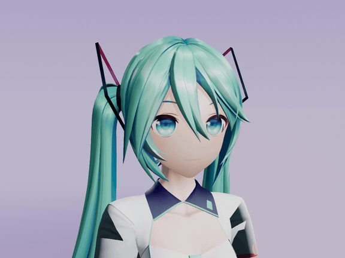
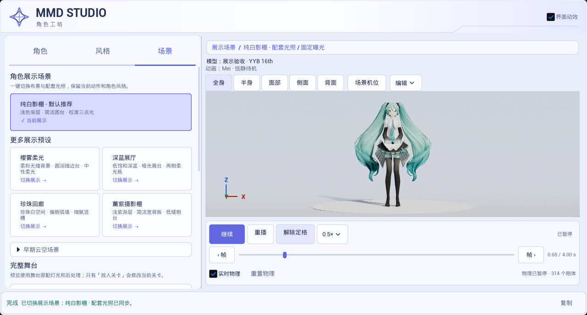

# Ue5MMDTools illustrated guide

From importing a PMX model to a finished MMD short. Pick a motion, lighting and camera in MMD Studio, then produce the current preview as an MP4.

[Finished clips](#finished-clips) · [Install the plugin](#install-the-plugin) · [Get a demo model](#get-a-demo-model) · [From character to short](#from-character-to-short) · [Your own VMD](#your-own-vmd) · [Credits](#credits)

The panel is currently **Chinese-only**. Every control below is written as the label you will actually see, with an English gloss on first use.

## Finished clips

  

**Hatsune Miku 10th anniversary · lavender studio · profile idle.** Captured offscreen in UE 5.8.3 with the `main` development build on 2026-11-05. 3.2 seconds, Bullet physics enabled, with a VMD blink morph layered on top. [Frame and capture record](https://github.com/treasureGrove/MMDUETools/blob/dev/MMD/Plugins/Ue5MMDTools/Docs/Screenshots/2026-11-05-nikki-face-fill/README.md)

To compare the same character under different lighting, the white studio, sakura haze, deep-blue gallery, pearl atrium and lavender studio all have finished clips. One second each, captured 2026-10-25. [Five-studio clip](docs/Screenshots/2026-10-25-studio-collection/studio-collection.mp4) · [Frame-by-frame comparison](https://github.com/treasureGrove/MMDUETools/blob/dev/MMD/Plugins/Ue5MMDTools/Docs/Screenshots/2026-10-25-studio-collection/README.md)

## Install the plugin

1. Download the UE 5.8.3 Win64 package and unpack it. Place `Ue5MMDTools/` in your project so the descriptor sits at `YourProject/Plugins/Ue5MMDTools/Ue5MMDTools.uplugin`. [Download](https://github.com/treasureGrove/MMDUETools/releases/latest)
2. Open your project, enable the plugin and restart when prompted. In the level editor choose **窗口（Window） → Ue5MMDTools**, or run `MMD.OpenPanel` from the editor console.

The release package is meant for your own project. The full development host — an `MMD.uproject` with additional plugin dependencies — lives on the [`dev` branch](https://github.com/treasureGrove/MMDUETools/tree/dev). To build from source, use the plugin directory from this repository with the UE 5.8 Win64 C++ toolchain. [Source build and compatibility](docs/ENDFIELD_PLUGIN_DISTRIBUTION.md)

## Get a demo model

The package ships no third-party PMX, textures or motion data. That keeps the download small and respects each author's distribution terms. To reproduce the images on this page, open [MODEL_SOURCES.md](MODEL_SOURCES.md), download the model from its original author page, and keep the PMX and its textures in their original relative layout. Then press **导入 PMX 模型**（Import PMX Model）in the panel. The imported character is saved in your project, so later sessions only need **加载已有角色**（Load Existing Character）.

## From character to short

Watch the full flow first: from a loaded character through motion, lighting, camera and background production. [Download the 19-second clip (MP4)](docs/Screenshots/2026-11-05-workflow-video/mmd_studio_workflow.mp4?raw=true) · [See the GIF on the project page](README.en.md)

### 1. Import a character and try motions

1. On the **角色**（Character）page press **导入 PMX 模型**, pick a `.pmx`, and keep its texture folder alongside it. When the status bar reports completion, check the model on the right. If you imported it before, use **加载已有角色** and pick the matching MMD Actor blueprint.
2. Try **恬静待机**（calm idle）, **轻柔呼吸**（soft breathing）, **侧头思考**（head tilt） or **整理衣摆**（adjust hem）. A standard MMD skeleton starts with the calm idle.
3. Turn on **实时物理**（real-time physics） at the bottom of the viewport to inspect hair and cloth. The model needs rigid bodies. Use **定格姿势**（freeze pose） to hold a pose while physics keeps running, or **暂停**（pause） and the frame-step buttons to stop motion and physics together.

### 2. Choose style, lighting and camera

1. Switch to **风格**（Style） and set the target to **预览角色**（preview character）. Press **预览风格 →** on a style card to try a material; **恢复原材质**（restore original materials） reverts it.
2. Switch to **场景**（Stage） and keep the default **纯白影棚**（white studio）, or pick another studio card to swap the set and its matching lighting.
3. Pick **全身 / 半身 / 面部 / 侧面 / 背面**（full / half / face / side / back） above the viewport. For a close-up, start from **面部** and adjust from there. **预览舞台**（preview stage） shows the full stage; **放入关卡**（add to level） places it in the current level.

*Actual panel, 2026-10-25. The white studio is highlighted on the left; playback, freeze and real-time physics sit in the bottom bar on the right.*

### 3. Produce the MP4

1. Save the character asset and any custom animation. Confirm the current motion, stage, style and perspective camera, then press **按当前预览制作**（produce from current preview） in the top-right corner.
2. Watch progress in the panel. When it finishes, press **播放成片**（play result） or **打开目录**（open folder） to find `mmd_movie.mp4`, frames and logs under `Saved/MMDProduction/`. **取消**（cancel） stops a running job.

Production starts at motion time 0 and writes a 30 fps MP4, reusing the preview resolution, speed and physics settings. It needs Windows D3D12 SM6, plus `ffmpeg` and `ffprobe` on the system PATH. [Button location and the 2026-11-04 capture](https://github.com/treasureGrove/MMDUETools/blob/dev/MMD/Plugins/Ue5MMDTools/Docs/Screenshots/2026-11-04-preview-production/README.md)

If the button stays disabled: save the character and animation, release the freeze, then check whether you are using a supported built-in stage, original materials or a built-in style, and a perspective camera. For a standalone VMD camera, audio, or reopening a finished sequence, see the [production workflow](docs/MMD_PRODUCTION_WORKFLOW.md).

## Your own VMD

On the **角色** page expand **导入自己的 VMD／表情／相机**（import your own VMD / morphs / camera）. **导入 VMD 动作** saves a motion asset; **追加表情** and **导入 VMD 相机** add morph curves or a camera as needed. To keep a built-in motion, import the matching VMD from [Resources/PreviewMotions](Resources/PreviewMotions/).

To keep editing in Sequencer, open **合成关卡序列**（compose level sequence）, check the character, animation and camera slots, then press **Create Master Sequence**. An imported camera fills the camera slot, and baked physics fills the compositor once the bake finishes. [Full panel reference](docs/TOOL_PANEL_GUIDE.md)

Native toon styles require UE 5.8.3 / CL58210709, Win64 D3D12 SM6, and Substrate plus the matching native backend. Skeletons, IK and morphs may need per-model adaptation. [Native rendering setup](docs/ENDFIELD_NATIVE_RENDERING_GUIDE.md) · [Rendering architecture](docs/RENDERING_ARCHITECTURE.md)

## Credits

- **Character**　Hatsune Miku, Crypton Future Media, INC. [Character license](https://piapro.jp/license/pcl)
- **Clip model**　Hatsune Miku 10th anniversary v1.02 by SANMUYYB (三目YYB). [Author's distribution page](https://bowlroll.net/file/146083)
- **Panel and studio models**　YYB Hatsune Miku 16th NoWing by SANMUYYB / 霁行Ralker / Delta幻黑. [Capture record](https://github.com/treasureGrove/MMDUETools/blob/dev/MMD/Plugins/Ue5MMDTools/Docs/Screenshots/2026-10-25-studio-collection/README.md)
- **Motion**　Wait of Mei, Breath of Mei by the MMDAgent Project Team, Nagoya Institute of Technology. The profile clip uses the first 3.2 seconds of Wait of Mei with added morphs. [Source and CC BY 3.0 license](Resources/PreviewMotions/README.md)

[Back to the project page](README.en.md)
