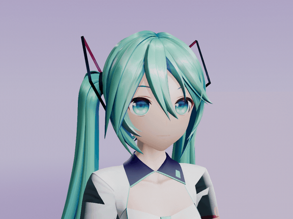
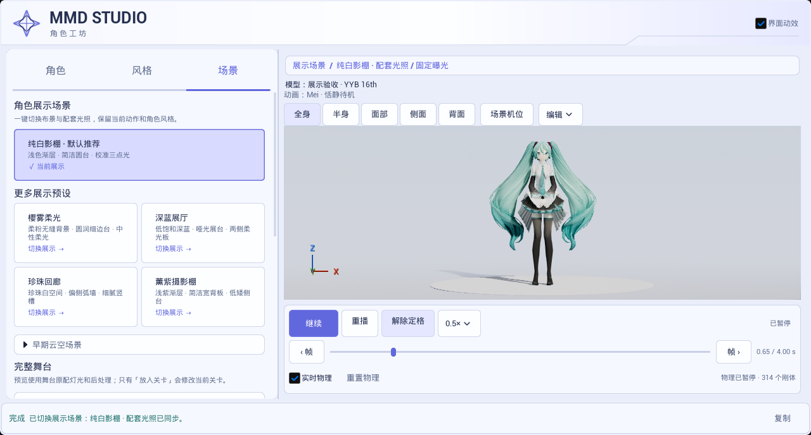

# Ue5MMDTools 图文操作指南

从导入 PMX 到输出一段 MMD 短片。先在角色工坊挑动作、布光和镜头，再把当前预览做成 MP4。

[成片预览](#成片预览) · [安装插件](#安装插件) · [从角色到短片](#从角色到短片) · [使用自己的 VMD](#使用自己的-vmd) · [借物表](#借物表)

## 成片预览

  

**10 周年初音未来 · 薰紫摄影棚 · 侧脸待机。** 2026-11-05 使用 `main` 开发版在 UE 5.8.3 中离屏捕获，3.2 秒，启用 Bullet 物理并追加 VMD 眨眼表情。[画面与捕获记录](MMD/Plugins/Ue5MMDTools/Docs/Screenshots/2026-11-05-nikki-face-fill/README.md)

想比较同一角色在不同光照下的效果，可以查看纯白影棚、樱雾柔光、深蓝展厅、珍珠回廊和薰紫摄影棚的实际成片。每套场景各展示 1 秒，捕获于 2026-10-25。[五套影棚短片](MMD/Plugins/Ue5MMDTools/Docs/Screenshots/2026-10-25-studio-collection/studio-collection.mp4) · [逐套画面对照](MMD/Plugins/Ue5MMDTools/Docs/Screenshots/2026-10-25-studio-collection/README.md)

## 安装插件

1. 下载 UE 5.8.3 Win64 插件包并解压。将 `Ue5MMDTools/` 放到自己的 UE 工程中，使插件文件位于 `YourProject/Plugins/Ue5MMDTools/Ue5MMDTools.uplugin`。[下载插件](https://github.com/treasureGrove/MMDUETools/releases/latest)
2. 打开工程，启用插件并按提示重启。进入关卡编辑器，选择 **窗口（Window） → Ue5MMDTools**。也可在编辑器控制台输入 `MMD.OpenPanel`。

使用发布包时直接打开自己的 UE 工程。仓库内的 `MMD.uproject` 是开发宿主，还声明了额外的插件依赖。需要从源码构建时，使用仓库里的插件目录和 UE 5.8 Win64 C++ 工具链。[插件源码](MMD/Plugins/Ue5MMDTools/) · [源码构建与兼容说明](MMD/Plugins/Ue5MMDTools/Docs/ENDFIELD_PLUGIN_DISTRIBUTION.md)

## 从角色到短片

先看一遍完整操作。视频从角色已载入开始，展示选动作、换布光、定镜头和后台导出。[下载约 19 秒的操作视频（MP4）](MMD/Plugins/Ue5MMDTools/Docs/Screenshots/2026-11-05-workflow-video/mmd_studio_workflow.mp4?raw=true) · [回到首页看动图节选](README.md#操作视频)

### 1. 导入角色并试动作

1. 在 **角色** 页点击 **导入 PMX 模型**，选择 `.pmx`，保留它与贴图的相对目录。底部提示完成后，在右侧检查模型。已导入过时，点击 **加载已有角色**，选择对应的 MMD Actor 蓝图。
2. 点击 **恬静待机**、**轻柔呼吸**、**侧头思考** 或 **整理衣摆** 试动作。标准 MMD 骨架加载后会先尝试恬静待机。
3. 在视口底部开启 **实时物理**，检查头发和衣物。模型需有刚体数据。想停在某个姿势又继续观察物理时，点 **定格姿势**。想停住动作和物理一起检查时，点 **暂停** 或使用逐帧按钮。

### 2. 选择风格、光照与镜头

1. 切到 **风格**，目标选 **预览角色**。点风格卡上的 **预览风格 →** 即可试材质，点 **恢复原材质** 可以撤回。
2. 切到 **场景**，可保留默认的 **纯白影棚**，或点击其他影棚卡切换布景与配套光照。
3. 在视口上方选择 **全身 / 半身 / 面部 / 侧面 / 背面**。想拍角色近景时可以先从 **面部** 机位开始，再调整视角。完整舞台可先点 **预览舞台**，需要加入当前关卡时再点 **放入关卡**。

*2026-10-25 的实际面板截图。左侧高亮当前纯白影棚，右侧底栏集中显示播放、定格与实时物理。*

### 3. 输出 MP4

1. 保存角色资产和自定义动画。确认当前动作、展示场景、风格及透视机位，再点击面板右上角 **按当前预览制作**。
2. 在面板查看进度。制作完成后，按底部状态提示到工程的 `Saved/MMDProduction/` 找到 `mmd_movie.mp4`。需要中止时可点 **取消**。

后台从动作第 0 秒开始，输出 30 fps MP4，沿用预览画幅、倍速和物理设置。需要 Windows D3D12 SM6，以及系统可调用的 `ffmpeg` 和 `ffprobe`。[制作按钮位置与 2026-11-04 实拍](MMD/Plugins/Ue5MMDTools/Docs/Screenshots/2026-11-04-preview-production/README.md)

如果按钮不可用，先保存角色和动画、解除定格，再检查是否用了受支持的内置展示场景、原材质或内置风格，以及透视机位。使用独立 VMD 镜头、音频或重新打开成片序列的方法见 [后台制作指南](MMD/Plugins/Ue5MMDTools/Docs/MMD_PRODUCTION_WORKFLOW.md)。

## 使用自己的 VMD

在 **角色** 页展开 **导入自己的 VMD／表情／相机**。用 **导入 VMD 动作** 保存动画资产，按需 **追加表情** 或 **导入 VMD 相机**。需要保存某个内置动作时，可从[动作目录](MMD/Plugins/Ue5MMDTools/Resources/PreviewMotions/)导入对应 VMD。

要在 Sequencer 里继续编辑，打开 **合成关卡序列**，核对角色、动画和相机槽，再点击 **Create Master Sequence**。导入相机会填入相机槽，物理烘焙完成后会把烘焙动画填入合成器。[完整面板操作](MMD/Plugins/Ue5MMDTools/Docs/TOOL_PANEL_GUIDE.md)

原生风格需要 UE 5.8.3／CL58210709、Win64 D3D12 SM6，以及启用 Substrate 和对应的原生后端。不同模型的骨骼、IK 和 Morph 可能需要适配。[原生渲染配置](MMD/Plugins/Ue5MMDTools/Docs/ENDFIELD_NATIVE_RENDERING_GUIDE.md) · [渲染架构](MMD/Plugins/Ue5MMDTools/Docs/RENDERING_ARCHITECTURE.md)

## 借物表

- **角色**　初音未来，Crypton Future Media, INC.。[角色许可](https://piapro.jp/license/pcl)
- **成片模型**　三目YYB（SANMUYYB）的初音未来 10 周年版 v1.02。[作者配布](https://bowlroll.net/file/146083)
- **操作图与影棚对照模型**　YYB Hatsune Miku 16th NoWing，SANMUYYB／霁行Ralker／Delta幻黑。[捕获记录](MMD/Plugins/Ue5MMDTools/Docs/Screenshots/2026-10-25-studio-collection/README.md)
- **动作**　Wait of Mei、Breath of Mei，名古屋工业大学计算机科学系 MMDAgent Project Team。侧脸成片截取 Wait of Mei 的前 3.2 秒，另配表情。[来源与 CC BY 3.0 许可](MMD/Plugins/Ue5MMDTools/Resources/PreviewMotions/README.md)

[返回仓库首页](README.md)
